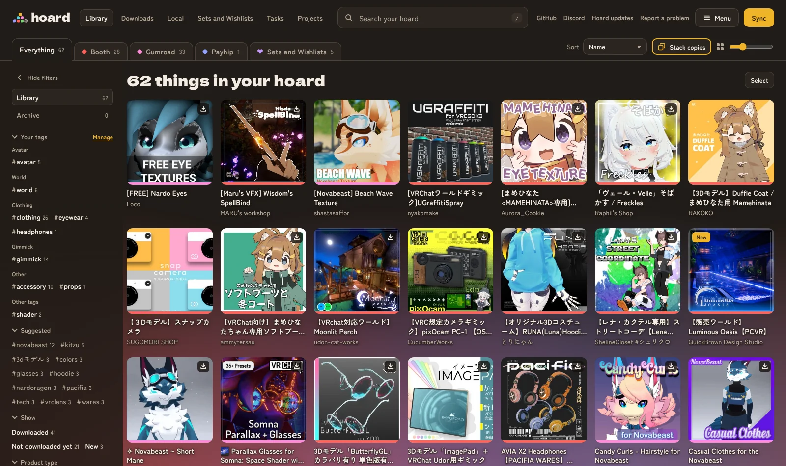
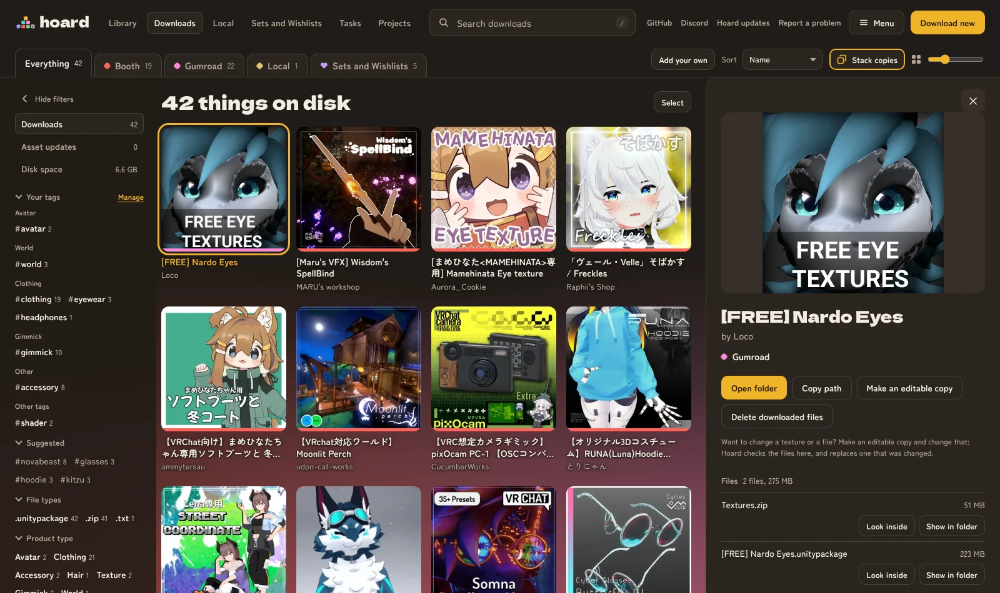
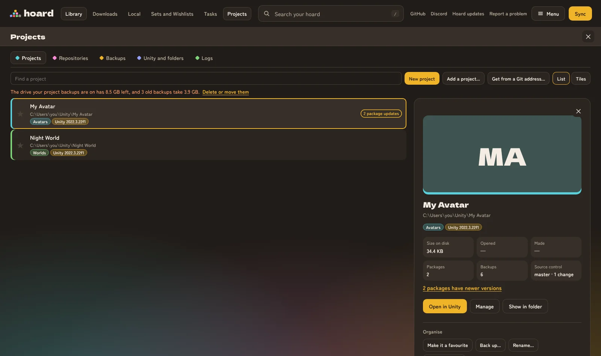
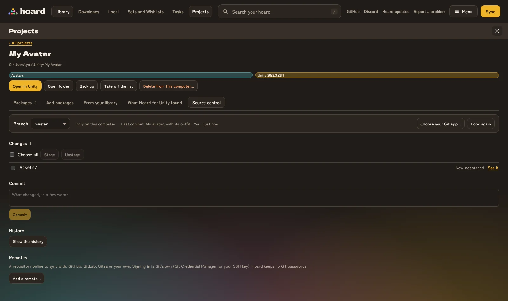
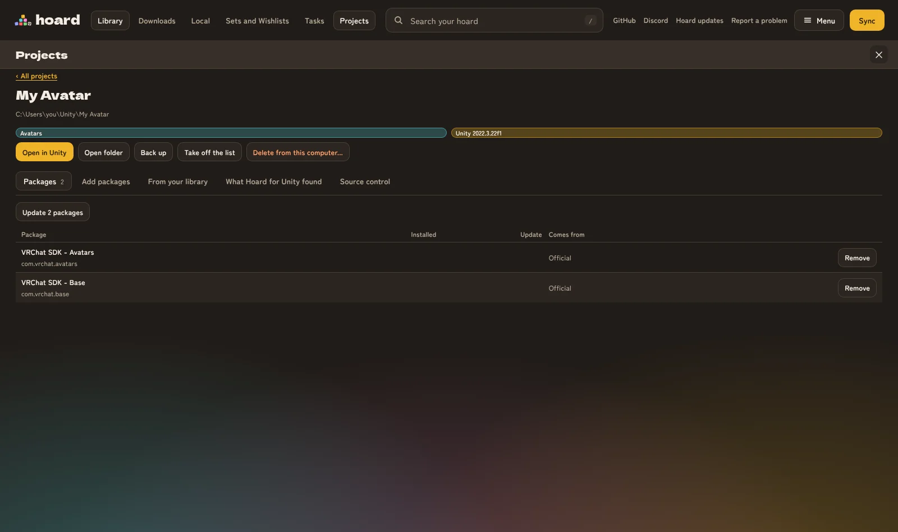
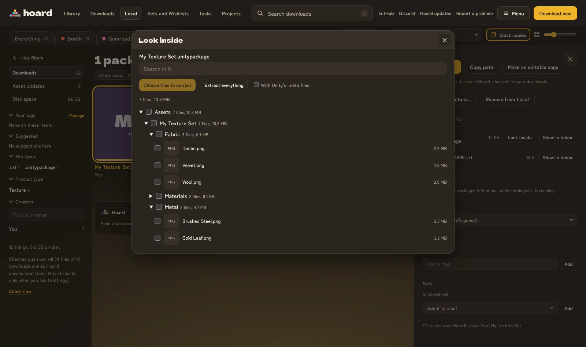
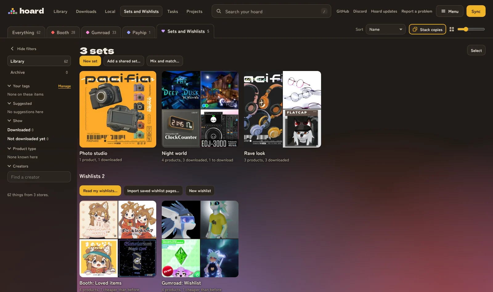
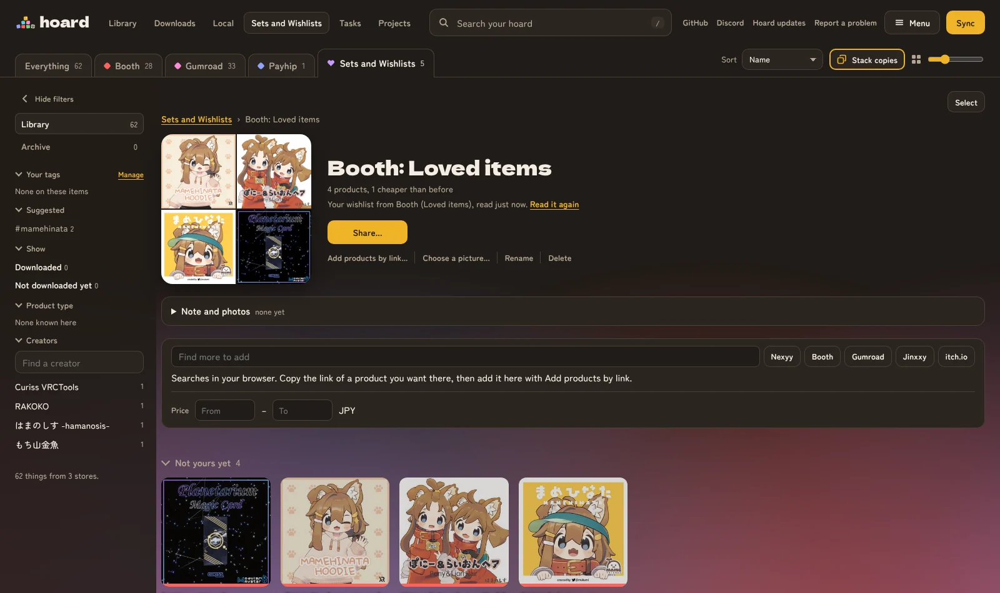
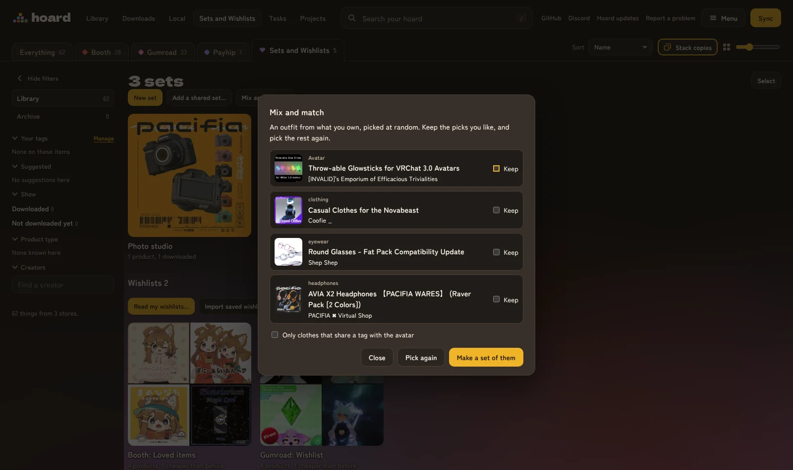
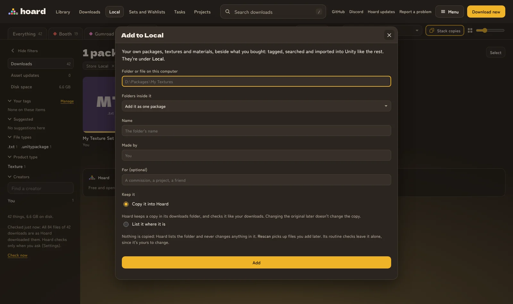

  <picture>
    <source media="(prefers-color-scheme: dark)" srcset="brand/logo-dark.svg">
    
  </picture>

<a href="README.md">English</a> · <a href="README.ja.md">日本語</a> · <a href="README.ko.md">한국어</a> · <b>Português (Brasil)</b>

  
  
  
  
  
  

<b>Todos os assets que você comprou para seus avatares e os projetos que criou com eles, juntos na mesma pilha.</b> 
Guarde suas compras do Booth, Gumroad, Jinxxy, Payhip e itch.io em uma só biblioteca.
Pesquise e filtre seus assets e gerencie os projetos que você cria com eles no Unity.

Você comprou aquele moletom. Foi no Booth ou no Gumroad? O criador lançou alguma atualização? Você ainda tem os
arquivos?
Com o Hoard, dá para descobrir tudo isso sem abrir quatro abas.

- Na **Biblioteca**, veja tudo o que você tem no Booth, Gumroad, Jinxxy, Payhip e itch.io em uma só página. Dá
  para pesquisar, filtrar e adicionar tags. O Hoard também identifica produtos que você tem em mais de uma loja.
- Em **Downloads**, guarde cópias locais em pastas organizadas por loja, criador e produto
  (`<Store>/<Creator>/<Product>`). O Hoard mantém as cópias em dia quando os criadores atualizam os arquivos. No
  caso do Payhip, o Hoard lista as compras e você baixa os arquivos pela loja, como explicado mais adiante.
- Em **Projetos**, acesse a mesma lista de projetos do Unity que aparece no Creator Companion e no ALCOM. Crie
  um projeto a partir dos modelos do VRChat e inclua produtos da sua biblioteca. Você também pode atualizar os
  pacotes, fazer backup e acompanhar o histórico com o Git.
- Um só aplicativo, um login por loja e as mesmas tags em todo o Hoard. Também funciona offline.

<picture>
  <source srcset="site/img/library-light.webp" media="(prefers-color-scheme: light)">
  
</picture>
<picture>
  <source srcset="site/img/downloads-details-light.webp" media="(prefers-color-scheme: light)">
  
</picture>
<picture>
  <source srcset="site/img/project-details-light.webp" media="(prefers-color-scheme: light)">
  
</picture>
<picture>
  <source srcset="site/img/project-git-light.webp" media="(prefers-color-scheme: light)">
  
</picture>
<picture>
  <source srcset="site/img/project-manage-light.webp" media="(prefers-color-scheme: light)">
  
</picture>
<picture>
  <source srcset="site/img/inside-light.webp" media="(prefers-color-scheme: light)">
  
</picture>
<picture>
  <source srcset="site/img/sets-light.webp" media="(prefers-color-scheme: light)">
  
</picture>
<picture>
  <source srcset="site/img/wishlist-light.webp" media="(prefers-color-scheme: light)">
  
</picture>
<picture>
  <source srcset="site/img/mix-light.webp" media="(prefers-color-scheme: light)">
  
</picture>
<picture>
  <source srcset="site/img/local-add-light.webp" media="(prefers-color-scheme: light)">
  
</picture>

As imagens mostram a biblioteca, os detalhes de um produto em Downloads e, na área de projetos, os detalhes de um projeto, o controle de versão e os pacotes. Também mostram como ver o conteúdo de um arquivo, organizar conjuntos, consultar uma lista de desejos, combinar peças e adicionar seus próprios itens. São produtos reais da biblioteca pessoal de quem mantém o Hoard, com as imagens dos próprios criadores. <a href="https://hoard.furryup.link/credits.html">Veja quem criou cada produto e onde encontrá-lo</a>. Agradecemos a todos que criaram esses assets.

A **[wiki](https://github.com/Soloflighter1010/Hoard-Asset-Manager/wiki)** tem guias que vão da instalação à
solução de problemas. Ela também está disponível em
[japonês](https://github.com/Soloflighter1010/Hoard-Asset-Manager/wiki/ホーム) e
[coreano](https://github.com/Soloflighter1010/Hoard-Asset-Manager/wiki/홈).

---

## 📖 Sumário

- [Instalação (Windows)](#instalação-windows)
- [Instalação (macOS e Linux)](#instalação-macos-e-linux)
- [Como usar o Hoard](#como-usar-o-hoard)
- [Hoard no Unity](#hoard-no-unity)
- [Como o Hoard protege você](#como-o-hoard-protege-você)
- [Acesso às suas contas](#acesso-às-suas-contas)
- [Tags](#tags)
- [Uso offline](#uso-offline)
- [Como relatar problemas e contribuir](#como-relatar-problemas-e-contribuir)
- [Para desenvolvedores](#para-desenvolvedores)
- [Informações legais](#informações-legais)

---

## Histórico de estrelas

<a href="https://www.star-history.com/?repos=soloflighter1010%2Fhoard-asset-manager&type=date&legend=bottom-right">
 <picture>
   <source media="(prefers-color-scheme: dark)" srcset="https://api.star-history.com/chart?repos=soloflighter1010/hoard-asset-manager&type=date&theme=dark&legend=bottom-right" />
   <source media="(prefers-color-scheme: light)" srcset="https://api.star-history.com/chart?repos=soloflighter1010/hoard-asset-manager&type=date&legend=bottom-right" />
   
 </picture>
</a>

---

## Instalação (Windows)

A partir da versão 5.2.0 beta 6, o Hoard usa o Tauri para a janela do aplicativo e o Nuitka para compilar o
servidor. O Windows o instala como um novo aplicativo. Se você já usa o Hoard, desinstale primeiro a versão
anterior. O
[guia de instalação](https://github.com/Soloflighter1010/Hoard-Asset-Manager/wiki/Installing-Hoard#moving-to-the-new-hoard)
explica como fazer isso. Sua biblioteca, suas configurações e seus logins são preservados.

1. Baixe **`Hoard-<version>-windows-setup.exe`** na
   [página de versões](https://github.com/Soloflighter1010/Hoard-Asset-Manager/releases) e execute o instalador.
   Ele instala o Hoard só para a sua conta, sem pedir permissão de administrador, e adiciona o aplicativo ao
   menu Iniciar. No Hoard 5.1, a
   [versão mais recente](https://github.com/Soloflighter1010/Hoard-Asset-Manager/releases/latest), o instalador
   se chama `Hoard-Setup-<version>.exe`.
2. Por algum tempo após o lançamento de uma versão, o Windows pode mostrar a mensagem
   **“O Windows protegeu o computador”**. O código do Hoard tem assinatura digital. Selecione
   **Mais informações** para ver o nome do fornecedor, que é a pessoa que mantém o projeto. Leva um tempo para
   um novo fornecedor ganhar a confiança da Microsoft. Saiba mais em [CODE_SIGNING.md](CODE_SIGNING.md). Para
   continuar, selecione **Executar assim mesmo**. Para verificar se o instalador foi gerado pelo próprio projeto
   no GitHub, execute
   `gh attestation verify Hoard-<version>-windows-setup.exe -R Soloflighter1010/Hoard-Asset-Manager`.
3. Abra o **Hoard** pelo menu Iniciar. Na janela do aplicativo, um assistente ajuda você a escolher o idioma e
   os recursos de acessibilidade, como tamanho do texto, fonte que facilita a leitura para pessoas com dislexia,
   espaçamento, cores e animações. Você também escolhe as lojas que usa, entra em cada uma, informa suas lojas
   do Payhip e escolhe onde salvar os downloads. Para repetir a configuração, abra **Settings** (Configurações)
   e selecione **Set up Hoard again**. Depois que o Hoard carregar sua biblioteca, um breve tour apresenta os
   outros recursos usando os seus próprios itens. Para revê-lo, abra **Settings** e selecione **Take the tour**.

**Para atualizar o Hoard**, abra **Settings › Hoard updates**, selecione **Check now** para buscar atualizações
e depois **Update to** para instalar a versão indicada. O Hoard fecha, e a janela de atualização baixa a nova
versão. Ela só prossegue se o arquivo tiver a assinatura gerada com a chave do próprio Hoard. Depois da
instalação, o aplicativo abre de novo. Ative **Check for updates automatically** para receber um aviso quando
houver uma atualização. Você também pode executar o novo instalador sobre a versão anterior. Suas configurações,
biblioteca, logins e tags ficam em `%LOCALAPPDATA%\Hoard`, e os downloads ficam na pasta escolhida para eles. A
instalação, a atualização e a desinstalação só alteram os arquivos do programa.

A janela do Hoard usa o Microsoft Edge WebView2, que já faz parte do Windows 11 e recebe atualizações no Windows
10.

## Instalação (macOS e Linux)

- **No macOS 11 ou posterior**, baixe `Hoard-<version>-macos-apple-silicon.dmg` (para Macs com chip da série M)
  ou `Hoard-<version>-macos-intel.dmg` (para Macs com processador Intel) na
  [página de versões](https://github.com/Soloflighter1010/Hoard-Asset-Manager/releases). Abra o arquivo e
  arraste o Hoard para **Aplicativos**. Como o app ainda não tem assinatura da Apple, o macOS bloqueia a
  primeira tentativa de abri-lo. Selecione **Concluído** e depois
  **Ajustes do Sistema › Privacidade e Segurança › Abrir Mesmo Assim**. A versão 5.1 do Hoard usa um instalador
  `.pkg`.
- **No Linux (x86_64)**, você pode usar o AppImage (`Hoard-<version>-linux-x86_64.AppImage`, que você precisa
  tornar executável antes de abrir), o pacote `.deb` para Debian e Ubuntu (`Hoard-<version>-linux-amd64.deb`) ou
  o Flatpak (`Hoard-<version>-linux-x86_64.flatpak`). Para instalar o Flatpak, abra o arquivo na central de
  aplicativos ou execute `flatpak install --user Hoard-<version>-linux-x86_64.flatpak`. Ele usa o ambiente de
  execução do GNOME distribuído pelo [Flathub](https://flathub.org/setup) e pode ser instalado sobre uma versão
  anterior do Hoard em Flatpak.

Em todos os formatos, o Hoard abre em sua própria janela. O aplicativo para Mac, o AppImage e o .deb têm o mesmo
sistema de atualização do Windows. Para atualizar o Flatpak, instale o arquivo `.flatpak` mais recente da mesma
forma que instalou o primeiro. A tela **Settings › Hoard updates** indica o método adequado à sua instalação.
Saiba mais no
[guia de instalação do Hoard](https://github.com/Soloflighter1010/Hoard-Asset-Manager/wiki/Installing-Hoard).

**Para executar a partir do código-fonte em qualquer sistema**, instale o
[Python 3.10 ou posterior](https://www.python.org/downloads/), baixe `Hoard-<version>.zip`, extraia o conteúdo e
execute `Hoard.bat` (Windows) ou `./run.sh`. O script prepara um ambiente Python exclusivo, confere a impressão
digital de cada pacote com o valor registrado e abre o Hoard.

**Você usa o Hoard 1.x?** Seus logins e tags são migrados automaticamente. Para trazer também a lista de
produtos da biblioteca e a pasta de downloads, selecione no assistente de configuração a pasta de onde você
executava a versão 1.x.

## Como usar o Hoard

- **Sync** (Sincronizar), no canto superior direito, consulta suas compras em cada loja e baixa tudo o que for
  novo em uma única operação. Você pode acompanhar o progresso e usar **Stop** para pausar com segurança.
- Em **Stores** (Lojas), no canto superior direito, entre uma vez em cada loja pela janela do navegador que se
  abre para ela. Use **Refresh** para atualizar a lista de compras, **Download** para baixar uma cópia local de
  cada novidade daquela loja ou **Download everything new** para baixar as novidades de todas as lojas.
- Com **Import pages** (Importar páginas), em **Stores**, você pode usar as páginas da sua biblioteca que
  salvou no navegador de costume com Ctrl+S e a opção “Página da Web, arquivo único”. Selecione várias páginas
  de uma vez, escolha uma pasta inteira ou arraste os arquivos para a janela. Isso ajuda quando uma loja
  bloqueia a atualização ou quando você prefere usar a sessão já aberta no seu navegador.
- Em **Library** (Biblioteca), você encontra tudo o que tem. Abra um item para ver os detalhes, adicionar tags,
  visitar a página da loja ou baixá-lo com **Download**. Os itens já salvos no computador aparecem com a
  indicação **On disk**, um link para o item em Downloads e um pequeno ícone de download na imagem. Na lateral
  esquerda, os filtros **Downloaded** e **Not downloaded yet** mostram, respectivamente, o que já foi baixado e
  o que ainda falta baixar.
- Em **Tasks** (Tarefas), você acompanha o progresso do que está em andamento, vê o que está na fila e consulta
  o que já terminou. Se iniciar uma tarefa enquanto outra estiver em execução, ela entra na fila. Você pode
  retirá-la da fila nessa mesma tela.
- Os painéis **Tags**, **Stores** e **Settings** abrem em janelas que você pode mover, redimensionar e manter
  lado a lado. As configurações são salvas a cada alteração.
- Em **Downloads**, você vê o que está no computador, com os respectivos arquivos, tamanhos e pastas.
  **Download new** baixa arquivos novos ou atualizados e mostra o progresso. Use **Stop** para pausar com
  segurança. Na próxima vez, o Hoard continua de onde parou.
  - Para conferir o que os criadores adicionaram ou alteraram desde o seu último download, use
    **Check for updates**, em **Updates**. A consulta não baixa arquivos. Depois, escolha **Update** para
    atualizar um produto ou **Update all** para atualizar todos.
  - Na lista de arquivos de um produto, **Look inside**, ao lado de um `.unitypackage` ou `.zip`, permite ver
    os arquivos organizados por pasta, com as prévias que o Unity guarda para eles, sem precisar extrair nada.
    Se abrir um `.zip`, você também pode ver o conteúdo de cada pacote do Unity que estiver nele.
  - Nos detalhes do produto, **What it needs** mostra as dependências que os pacotes usam e que precisam ser
    obtidas à parte. Elas podem incluir shaders e ferramentas como lilToon, Poiyomi ou Modular Avatar. O Hoard
    também indica se o produto usa arquivos de outros produtos, como um avatar base.
  - Quando uma atualização substitui um arquivo, a cópia anterior fica em **Previous versions** (Versões
    anteriores). Use **Restore** para recuperá-la.
  - Em **Sets** (Conjuntos), você pode agrupar produtos que usa juntos, como um avatar, suas roupas e seus
    shaders, mesmo que ainda não tenha baixado todos. Os conjuntos ficam em uma aba ao lado das lojas. Cada
    conjunto aparece como um cartão grande, que pode ter uma imagem à sua escolha. Ao abri-lo, você vê uma pasta
    com os produtos. Você pode compartilhar o conjunto por um link curto que, por 14 dias, mostra o que ele
    contém e onde comprar cada produto. Antes do compartilhamento, o Hoard criptografa os dados para que o
    servidor de compartilhamento não consiga lê-los. Com o Hoard for Unity, dá para importar o conjunto inteiro
    de uma vez.
- A opção **Backup**, em **Settings**, permite salvar em um único arquivo suas configurações, tags, conjuntos,
  preferências e a lista de produtos da biblioteca. Você pode guardar esse arquivo, levá-lo para outro
  computador e restaurar os dados. O backup não inclui logins nem chaves.
- No **Payhip**, o Hoard lista tudo o que você comprou e mostra a página de download de cada produto. Você
  baixa os arquivos diretamente pelo Payhip. As compras ficam separadas por loja, e cada loja tem sua própria
  biblioteca. A forma mais fácil de importar tudo é salvar todas as páginas da biblioteca de cada loja e
  importá-las de uma só vez. Se alguma loja ainda não estiver cadastrada, o Hoard pede sua confirmação antes de
  adicioná-la. Você também pode cadastrar as lojas em **Settings › Payhip shops** usando o endereço que consta
  no e-mail da compra e depois atualizar a lista. Como o Payhip verifica se o navegador é automatizado, o Hoard
  abre uma janela para você concluir a verificação.
- Para entrar no **itch.io**, o Hoard usa uma chave de API, assim como o aplicativo oficial do itch.io. O site
  não permite login por senha em navegadores automatizados. Em **Stores**, selecione **Add API key** na linha do
  itch.io. O Hoard mostra onde criar a chave, confirma com o itch.io se ela é válida e a armazena usando a
  proteção do seu sistema operacional. Em seguida, lê e baixa tudo o que consta na sua biblioteca do itch.io,
  tanto as compras quanto os itens que você resgatou em pacotes promocionais ou em páginas do tipo “pague quanto
  quiser”. O Hoard confere a soma de verificação de cada arquivo com a fornecida pelo itch.io. Se você
  configurou o Hoard antes da versão 2.5.0, ative primeiro o itch.io em **Settings**. Por padrão, o Hoard ignora
  as versões de jogos que o criador marcou para Windows, macOS, Linux ou Android, para os jogos da biblioteca
  não encherem seu disco. Para baixá-las também, desative **Skip game builds** em **Settings**.
- **Para entrar sem as senhas salvas no seu navegador**, siga as orientações do assistente. O Hoard usa um
  navegador próprio e não tem acesso às senhas salvas no navegador do dia a dia. O assistente mostra onde
  encontrá-las e como copiá-las no Chrome, Edge, Firefox, Safari ou em um gerenciador de senhas. Se uma loja
  enviar um link de login ou de confirmação por e-mail, copie o link e cole-o no assistente para que ele abra na
  janela do Hoard.
- Na lateral esquerda ficam **Archive**, **Removed** e **Hidden**. Abra um item ou marque vários com
  **Select**. Use **Archive** para arquivar produtos antigos que você quer tirar de vista (as compras que você
  já arquivou no Gumroad aparecem ali desde o início). Use **Remove** para tirar itens que não deveriam estar na
  biblioteca. Eles ficam de fora mesmo depois de atualizar a lista, e você pode excluí-los de vez em
  **Removed**. Use **Hide** para ocultar itens com um PIN. Os itens ocultos somem de todas as telas, inclusive
  de Downloads, até que você os desbloqueie naquele navegador. O PIN só controla o que aparece na interface. Os
  arquivos no disco continuam como arquivos comuns, sem criptografia adicional. Ao definir o PIN, o Hoard mostra
  seis palavras de recuperação uma única vez. Anote-as para poder redefinir o PIN sem perder os itens ocultos
  caso você o esqueça.
- Em **Settings**, você escolhe onde salvar os downloads (por padrão, na pasta `Hoard` dentro de Documentos),
  quais lojas incluir e qual navegador usar para entrar nas lojas (por padrão, o Microsoft Edge). Também pode
  escolher o idioma da interface entre inglês, 日本語 (japonês) e 한국어 (coreano), ou deixar que o Hoard use o idioma
  do computador se for um desses três.
- As **tags** funcionam da mesma forma na biblioteca e em Downloads. Consulte a seção [Tags](#tags).

## Hoard no Unity

O **Hoard for Unity** leva os arquivos baixados pelo Hoard para o editor do Unity. Na barra de menus do Unity,
abra **Hoard › Open Hoard**. Você pode pesquisar nos downloads e reconhecer os produtos pelas miniaturas e ver
quais produtos já estão no projeto aberto. Para identificá-los, o Hoard lê os GUIDs dos assets dentro de cada
`.unitypackage`. Use **Import** para abrir a janela de importação do próprio Unity sem baixar os arquivos de
novo. Se o produto veio em um arquivo compactado, como acontece com muitos produtos do Booth, os pacotes
aparecem dentro do respectivo `.zip`. Nesse caso, **Import** extrai apenas o pacote escolhido e abre a mesma
janela. Se faltar um shader ou uma ferramenta de que o pacote precisa, o Hoard indica o que falta, e **Import**
pede confirmação antes de prosseguir. O plugin apenas lê o catálogo do Hoard, verifica seu selo de integridade e
funciona exclusivamente no editor. Nada do plugin é incluído nos seus uploads.

Para adicionar o plugin ao VRChat Creator Companion, abra o [site do Hoard](https://hoard.furryup.link/#unity) e
selecione **Add to VCC**. Você também pode abrir **Settings › Packages › Add Repository** no VCC e colar
`https://hoard.furryup.link/index.json`. Depois, adicione **Hoard** a um projeto. Se você não usa o VCC, importe
o `.unitypackage` de uma das versões do plugin (“Hoard for Unity ...”, com uma tag `unity-v...`) disponíveis na
[página de versões](https://github.com/Soloflighter1010/Hoard-Asset-Manager/releases?q=unity-v&expanded=true).
Veja mais em [Packages/soloflighter.hoard/README.md](Packages/soloflighter.hoard/README.md).

Também é possível usar todos os recursos pela linha de comando, inclusive em scripts e em computadores sem
interface gráfica. Consulte [docs/COMMAND-LINE.md](docs/COMMAND-LINE.md).

## Como o Hoard protege você

Veja como essas proteções funcionam no dia a dia. Os detalhes técnicos estão em [SECURITY.md](SECURITY.md).

**Suas contas nas lojas**

- **O Hoard nunca vê suas senhas.** Você entra na página da própria loja. O Hoard só guarda a credencial que a
  loja fornece para manter a sessão aberta, assim como o seu navegador.
- **Seu computador protege essa credencial.** Ela é criptografada com a proteção da sua conta do Windows, das
  Chaves do macOS ou do chaveiro do Linux. Copiar os arquivos do Hoard para outro computador não dá acesso às
  suas contas.
- **Cada loja tem uma sessão separada.** Os dados de login do Booth e do Gumroad, por exemplo, nunca se
  misturam.
- **Sair da conta encerra a sessão de verdade.** O Hoard pede à loja que encerre a sessão, apaga os dados de
  login que guardou, verifica se sobrou alguma coisa e informa o que fez. Os itens daquela loja também saem da
  biblioteca para que a próxima pessoa a entrar não veja suas compras. Os arquivos que você baixou continuam no
  disco.

**Seu computador**

- **Só você pode ver as páginas do Hoard.** Por padrão, elas só abrem no computador que executa o aplicativo.
  Para acessá-las em outros dispositivos seus, você precisa ativar o compartilhamento, que exige uma conexão
  segura e uma chave.
- **Outros sites não podem usar o Hoard contra você.** Eles não conseguem ler as páginas do Hoard, acionar seus
  botões ou ocultar o aplicativo dentro das próprias páginas.
- **O conteúdo exibido das lojas não executa código no seu computador.** O Hoard exibe nomes, links e imagens
  das lojas como texto e imagens comuns.
- **Os downloads só acessam os destinos previstos.** O Hoard verifica cada etapa de cada download e de cada
  solicitação às lojas. Só permite conexões seguras e bloqueia destinos que apontem para o seu computador ou
  para a rede doméstica. As credenciais de uma loja só são enviadas à própria loja. Os servidores que hospedam
  os arquivos não recebem essas credenciais.
- **O Hoard não busca imagens na sua rede doméstica.** Ele busca as imagens dos produtos apenas na internet
  pública, sem acessar o roteador, o NAS ou outros dispositivos da sua rede.

**Seus arquivos**

- **Os downloads ficam na sua pasta de downloads.** Nenhum dado enviado por uma loja ou gravado nos registros
  do Hoard pode fazer o aplicativo salvar um arquivo em outro lugar.
- **O Hoard remove caracteres ocultos dos nomes de arquivo.** Isso evita que o nome de um programa pareça o de
  uma imagem. Por exemplo, um arquivo chamado `Hoodie…exe` não pode aparecer como `Hoodie…jpg` por causa desses
  caracteres.
- **Os botões das lojas só abrem a loja verdadeira.** O botão **Open on Booth**, por exemplo, só pode abrir o
  domínio booth.pm. Ninguém pode trocar o destino por uma página falsa de login.
- **O Hoard detecta adulterações.** Ele aplica um selo de integridade a cada registro que grava. Se outro
  programa alterar um registro, o Hoard avisa, guarda uma cópia para você examinar e deixa de confiar nos links
  alterados.
- **Um arquivo danificado não interrompe o aplicativo.** O Hoard separa o arquivo para você examiná-lo e
  continua funcionando.

**O próprio Hoard**

- **Outras pessoas que usam seu computador não podem alterar o Hoard.** O instalador configura os arquivos do
  programa para que só a sua conta possa modificá-los.
- **O instalador verifica o que vai instalar.** Ele compara a impressão digital de cada pacote com o valor
  registrado previamente. Se detectar adulteração, não instala o pacote. O navegador vem da fonte oficial, em
  uma versão específica.
- **As versões são compiladas publicamente.** O GitHub gera cada versão diretamente do código-fonte e publica
  as somas de verificação correspondentes. Assim, você pode confirmar a autenticidade do arquivo baixado.
- **Cada alteração passa por testes de segurança automáticos** antes do lançamento.

**Sua privacidade**

- **Nada é enviado a quem desenvolve o Hoard.** O aplicativo dispensa a criação de uma conta própria e não tem
  rastreamento, análise de uso nem anúncios. Ele se comunica apenas com as lojas que você usa e, em duas
  situações específicas, com outros serviços. Ao criar um link curto para um conjunto, o Hoard usa seu servidor
  de compartilhamento, que armazena o conteúdo criptografado sem conseguir lê-lo. Ao adicionar a foto de um
  conjunto usando a página dela em um site de fotos, o Hoard acessa esse site. O documento
  [PRIVACY.md](PRIVACY.md) explica quais dados o aplicativo armazena e como apagá-los.
- **O Hoard funciona offline** para tudo, exceto atualizar os dados das lojas, entrar nas contas e baixar
  arquivos.

**Riscos dos quais nenhum aplicativo pode proteger você**

- **Malware que já está no computador.** Um vírus executado com as permissões da sua conta pode usar suas
  sessões nas lojas assim como você. Mantenha o sistema atualizado e faça verificações de segurança.
- **Alguém com acesso de administrador** ao seu computador.
- **Problemas nos sites das próprias lojas.**

**Cuidados que você pode tomar**

- Mantenha o Hoard em uma pasta sua, por exemplo, dentro da sua pasta de usuário.
- Nunca compartilhe a pasta de dados do Hoard, indicada a seguir. Ela contém seus dados de login.
- Antes de compartilhar arquivos de diagnóstico, confira o conteúdo. Eles podem mostrar o que você comprou.
- Quando sair uma nova versão, atualize o Hoard em **Settings › Updates**.

## Acesso às suas contas

Você entra em cada loja por uma janela de navegador exclusiva do Hoard. A biblioteca e a área de downloads
compartilham essa sessão, então basta entrar uma vez por loja. Os dados de login ficam em uma pasta separada
para cada loja dentro do caminho correspondente ao seu sistema.

| Windows | macOS | Linux |
|---|---|---|
| `%LOCALAPPDATA%\Hoard\sign-ins` | `~/Library/Application Support/Hoard/sign-ins` | `~/.local/share/Hoard/sign-ins` |

- **No macOS**, o sistema pergunta uma vez se o navegador do Hoard pode usar as Chaves. Selecione
  **Permitir Sempre**.
- **No Linux**, é preciso ter um chaveiro para proteger os dados de login. Pode ser o GNOME Keyring, o
  KeePassXC com o Secret Service ativado ou o KWallet. Sem um chaveiro, o Hoard não salva os logins. Em um
  computador sem interface gráfica, como um NAS, você pode permitir o armazenamento sem chaveiro definindo
  `"allow_unprotected_signins": true` no `config.json` do Hoard. Nesse caso, a única proteção é a permissão de
  leitura restrita à sua conta de usuário.
- **Para sair das contas**, abra **Stores** e escolha uma loja ou todas. Os itens da loja saem da biblioteca, e
  os arquivos já baixados ficam no disco. Assim, as compras de pessoas que compartilham o computador não se
  misturam.
- **Os dados de login das versões anteriores** ficavam em uma pasta compartilhada entre as lojas ou na pasta
  `.browser-profile` ao lado do programa. Na primeira execução, o Hoard os separa automaticamente em uma pasta
  por loja e remove as cópias antigas.

**Para usar a mesma pasta de downloads em dois computadores** (em um NAS, por exemplo), as duas instalações
precisam usar a mesma chave para reconhecer os registros uma da outra. Por padrão, cada instalação do Hoard usa
sua própria chave para selar os registros. Cada uma trataria as alterações da outra como não verificadas e
buscaria os links das lojas novamente. Para compartilhar a pasta, copie `integrity.key` da pasta de dados do
Hoard em um computador para o mesmo local no outro.

## Tags

O Hoard tem dois tipos de tags.

- **Suas tags** são as que você cria e adiciona aos itens.
- **Tags sugeridas** são palavras que aparecem no nome de vários itens. Por exemplo, `FoxyHoodie v2` gera as
  sugestões `foxy` e `hoodie`. O Hoard descarta palavras pouco informativas e números de versão.

Você pode aplicar e organizar as tags de várias formas.

- **Para um item**, abra-o e digite uma tag em **Tags** ou clique em uma sugestão para adicioná-la. Para
  remover uma tag, clique no × ao lado dela. A tag que você adiciona também se aplica a todas as cópias do mesmo
  produto que você tem em outras lojas.
- **Para vários itens**, marque as caixas de seleção, clique nos itens segurando Ctrl ou Shift, ou ative
  **Select** e clique nos itens desejados. Também dá para filtrar, por exemplo, por criador, e usar
  **Select all shown** para selecionar tudo o que aparece. Depois, abra **Tags** na barra de seleção ou clique
  com o botão direito e escolha **Add a tag** para adicionar uma tag ou **Remove a tag** para removê-la.
- **O painel de tags**, acessível pelo botão **Tags**, reúne suas tags e as sugestões.
  - Use **Keep** para transformar uma sugestão em uma tag sua. Ela será aplicada a todos os itens cujo nome
    contenha aquela palavra, inclusive os que você comprar no futuro. Use **Hide** para que a sugestão deixe de
    aparecer.
  - Use **Rename** para renomear uma tag. Se você der a ela o nome de uma tag existente, as duas serão
    mescladas.
  - Use **Match names** para ativar essa mesma correspondência automática por nome em qualquer tag. Para
    excluir uma tag, use **Delete**.

Suas tags ficam na pasta privada de dados do Hoard (`%LOCALAPPDATA%\Hoard\tags.json` no Windows). A biblioteca e
a área de downloads usam as mesmas tags, então uma tag adicionada em uma tela também aparece na outra. Na barra
lateral, você pode filtrar por qualquer tag e combinar vários filtros.

## Uso offline

Sem conexão com a internet, você pode usar todos os recursos do Hoard, exceto atualizar os dados das lojas,
entrar nas contas e baixar arquivos. O Hoard salva a imagem de cada produto sempre que atualiza a biblioteca.
Assim, toda a biblioteca, a busca e as imagens ficam disponíveis offline. As fontes já vêm com o aplicativo.
Quando uma loja está inacessível, o Hoard avisa e preserva a biblioteca e os downloads que você já salvou.

## O que você precisa saber

- O Hoard é um aplicativo não oficial. Booth (pixiv), Gumroad, Jinxxy, Payhip e itch.io não têm vínculo com o
  projeto nem o endossam. Ele só consulta as compras das suas próprias contas usando os seus dados de login.
- Quando uma loja muda o site, o leitor daquela loja pode parar de funcionar até receber uma atualização. O
  Payhip já faz verificações para detectar navegadores automatizados. Você pode concluir a verificação na janela
  que o Hoard abre ou importar as páginas que salvou no seu navegador.
- Baixar um asset não muda o que você tem permissão para fazer com ele. Respeite a licença de cada criador e os
  termos de cada loja.

## Como relatar problemas e contribuir

- **Encontrou uma falha?** Abra um
  [relatório de bug](https://github.com/Soloflighter1010/Hoard-Asset-Manager/issues/new?template=bug_report.yml)
  e descreva o que você fez e o que aconteceu. Se o Hoard não estiver lendo os dados de uma loja corretamente,
  execute `Hoard.bat debug <store>` ou `Hoard.bat probe jinxxy`. Confira o resultado antes de anexá-lo. Esses
  arquivos mostram suas compras, e as capturas de tela podem revelar o nome da sua conta.
- **Tem uma ideia para facilitar o uso do Hoard?** Envie uma
  [sugestão de recurso](https://github.com/Soloflighter1010/Hoard-Asset-Manager/issues/new?template=feature_request.yml).
- **Quer usar o Hoard com outra loja?** Faça um
  [pedido de integração de loja](https://github.com/Soloflighter1010/Hoard-Asset-Manager/issues/new?template=storefront_integration.yml).
- **Tem uma dúvida ou precisa de ajuda?** Abra um tópico na
  [área de discussões](https://github.com/Soloflighter1010/Hoard-Asset-Manager/discussions).
- **Encontrou um problema de segurança?** Envie o relato em particular, conforme as instruções em
  [SECURITY.md](SECURITY.md).

## Feito com IA

O Claude, assistente de IA da Anthropic, produziu a maior parte do código, do design e da documentação do Hoard.
A pessoa responsável pelo projeto orientou esse trabalho e testou os resultados. Isso inclui as traduções do
aplicativo e deste README para japonês e coreano. Algumas expressões podem soar estranhas nesses idiomas. Se
encontrar uma delas,
[avise a gente](https://github.com/Soloflighter1010/Hoard-Asset-Manager/issues/new?template=translation.yml). O
documento [AI-DISCLOSURE.md](AI-DISCLOSURE.md) explica o que isso significa para você. O Hoard em si não usa IA
e nunca envia seus dados a uma IA.

## Para desenvolvedores

O documento [docs/ARCHITECTURE.md](docs/ARCHITECTURE.md) explica como o Hoard funciona por dentro. Ele descreve
os leitores das lojas, os logins, os servidores locais e suas regras de segurança, além do processo de
lançamento. A implementação do plano de arquitetura e as medições que ainda faltam no aplicativo para desktop
podem ser acompanhadas em [docs/ROADMAP-315.md](docs/ROADMAP-315.md). Há guias específicos sobre a
[estrutura do aplicativo (app shell)](docs/APP-SHELL.md), o [armazenamento privado](docs/STORAGE.md), os
[adaptadores das lojas](docs/STORES.md), o [agendador de tarefas em segundo plano](docs/SCHEDULER.md) e a
[referência da API HTTP gerada automaticamente](docs/API.md). Na wiki, as páginas de
[desenvolvimento](https://github.com/Soloflighter1010/Hoard-Asset-Manager/wiki/Development) e
[publicação de versões](https://github.com/Soloflighter1010/Hoard-Asset-Manager/wiki/Releasing) explicam passo a
passo como executar os testes e publicar uma versão. O conteúdo da wiki é escrito em `wiki/` e publicado pelo
fluxo de trabalho **Wiki**.

Para publicar uma versão, aumente o valor de `__version__` em `hoard/__init__.py`, adicione uma seção a
`CHANGELOG.md` e envie uma tag como `v2.0.1` para o repositório remoto. O GitHub Actions gera o ZIP e publica a
versão com a respectiva lista de alterações. Para gerar o mesmo ZIP localmente na pasta `dist/`, execute
`python scripts/build_release.py`.

Este repositório também é um projeto do Unity e segue a estrutura do
[template-package](https://github.com/vrchat-community/template-package) do VRChat. Abra a pasta no Unity 2022.3
para trabalhar no Hoard for Unity em `Packages/soloflighter.hoard`. Para lançar uma versão do plugin, aumente o
valor de `version` no `package.json` e adicione uma seção ao `CHANGELOG.md` do pacote. A publicação cria uma tag
no formato `unity-v<version>`. O fluxo **Build Release** publica o `.zip`, o `.unitypackage` e o `package.json`.
Depois, **Build Repo Listing** atualiza a listagem do repositório para o VCC no GitHub Pages. Na configuração
inicial do repositório, crie a variável `PACKAGE_NAME` com o valor `soloflighter.hoard` e, em
**Settings › Pages › Source**, selecione **GitHub Actions**.

## Informações legais

- Licença MIT — [LICENSE](LICENSE)
- Termos de uso — [TERMS.md](TERMS.md)
- Política de privacidade — [PRIVACY.md](PRIVACY.md)
- Direitos autorais, uso do nome e do logotipo, software de terceiros e créditos — [COPYRIGHT.md](COPYRIGHT.md)
- Como relatar problemas de segurança — [SECURITY.md](SECURITY.md)
- Política de assinatura de código — [CODE_SIGNING.md](CODE_SIGNING.md)

Os arquivos do logotipo ficam em `brand/`. O símbolo se chama Heap (“pilha”). Há uma caixa para cada loja, uma
com um cubo para representar os projetos e uma dourada no topo. O desenho é gerado por `hoard/heap.py`. O
comando `python3 scripts/heap_files.py --write` aplica o desenho aos arquivos da marca e às páginas do
aplicativo. O script `scripts/make_icons.py` usa o mesmo desenho para gerar os ícones dos aplicativos. O nome
Hoard no logotipo foi convertido em curvas a partir da fonte Dela Gothic One, então os arquivos dispensam a
instalação de fontes. A pasta `brand/banners/` contém os banners do Hoard para um grupo do VRChat (1920 × 1080),
X e Bluesky (1500 × 500), YouTube (2560 × 1440), Discord (960 × 540) e a prévia de compartilhamento do GitHub
(1280 × 640). Em cada banner, os elementos principais ficam na área que a plataforma sempre exibe. O script
`scripts/make_banners.py` gera essas imagens.
